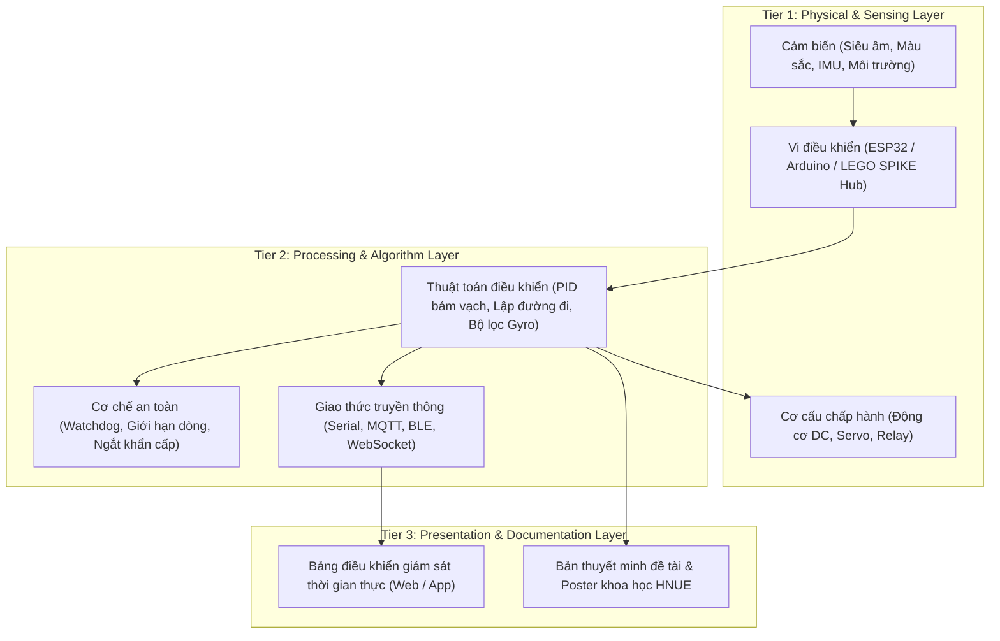

# ARCHITECTURE.md — HNUE Olympic STEM System Architecture

> **Mục tiêu:** Kiến trúc hệ thống giải pháp STEM phục vụ Cuộc thi Olympic STEM HNUE của Marie Curie Academy (MCA).
> **Tiêu chuẩn:** Thiết kế mô-đun hóa, phân tách rõ ràng giữa Tầng Thu thập Dữ liệu (Sensing), Tầng Xử lý & Điều khiển (Controller/Logic), và Tầng Hiển thị / Báo cáo (Telemetry & UI).

---

## 1. System Overview & 3-Tier Layered Architecture

Hệ thống được thiết kế theo 3 phân tầng công nghệ khép kín:

---

## 2. Architecture Invariants (Bất biến Kiến trúc)

1. **Fail-Safe Mechanism:** Cơ cấu chấp hành phải dừng ngay lập tức (Zero-Torque/Brake) khi mất tín hiệu cảm biến hoặc mất kết nối quá 500ms.
2. **Deterministic Control Loop:** Chu kỳ vòng lặp điều khiển chính (Control Loop Rate) duy trì tối thiểu 20Hz - 50Hz, không bị block bởi I/O hoặc logging.
3. **Reproducibility (Tính tái lập):** Mọi cấu hình thuật toán và hệ số PID / ngưỡng cảm biến phải lưu dưới dạng file cấu hình (`config.json` hoặc hằng số `constants.h`), không hardcode trong luồng thực thi.
4. **Offline Capability:** Hệ thống mô hình thực nghiệm phải hoạt động 100% độc lập không phụ thuộc Internet công cộng khi vào phòng thi sa bàn.

---

## 3. Module Boundaries & Data Flow

| Phân hệ | Đầu vào (Input) | Đầu ra (Output) | Hợp đồng giao tiếp (Contract) | Xử lý lỗi (Failure Mode) |
| --- | --- | --- | --- | --- |
| **Sensing Module** | Tín hiệu ADC, I2C, SPI từ cảm biến | Dữ liệu vật lý đã chuẩn hóa qua lọc nhiễu | Struct / JSON Telemetry | Báo lỗi Timeout, trả về giá trị an toàn mặc định |
| **Decision Core** | Trạng thái cảm biến + Mục tiêu bài toán | Lệnh điều khiển xung PWM / Tốc độ / Hướng lái | Command Dispatcher API | Dừng chuyển động, phát tín hiệu còi/đèn cảnh báo |
| **Actuator Driver** | Lệnh PWM, góc quay Servo | Chuyển động cơ khí, lực đẩy, góc lái | Driver Hardware Interface | Ngắt cầu H khi quá dòng hoặc kẹt cơ |
| **Telemetry & Log** | Dữ liệu nội bộ từ Controller | Biểu đồ trực quan, file CSV log | Serial / WebSocket Stream | Lưu vào bộ nhớ đệm tròn (Ring Buffer) tránh tràn RAM |

---

## 4. Key Architectural Decisions (ADR Summary)

| Ngày | Quyết định kiến trúc | Lý do lựa chọn | Đánh giá lại khi |
| --- | --- | --- | --- |
| 2026-11-09 | Áp dụng chuẩn AOK/RCP của Antigravity Engine cho toàn dự án | Đảm bảo tính nhất quán, lưu vết nhiệm vụ và kiểm thử tự động | Quy mô dự án mở rộng thành liên trường |
| 2026-11-09 | Phân tách độc lập mã nguồn điều khiển (`src/`) và tài liệu học thuật (`docs/`) | Dễ dàng chia sẻ cho học sinh và xuất bản hồ sơ dự thi | Có yêu cầu đóng gói phần mềm thành thư viện chung |
