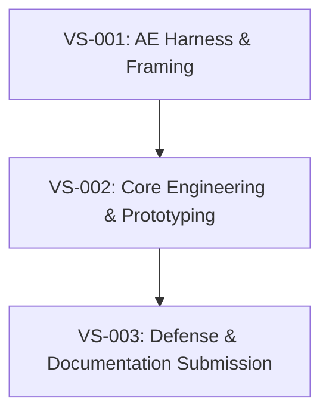

# DELIVERY_PLAN.md — HNUE Olympic STEM (MCA)

Use this file to plan project delivery as vertical slices for the HNUE Olympic STEM competition.

## Project Goal

Xây dựng, phát triển và hoàn thiện giải pháp STEM / Robotics đạt chuẩn giải thưởng cao tại Cuộc thi Olympic STEM Đại học Sư phạm Hà Nội (HNUE) cho trường Marie Curie Academy (MCA), bao gồm hồ sơ kỹ thuật, mã nguồn, mô hình thực nghiệm và bài thuyết minh bảo vệ.

## Milestones

| Milestone | Goal | Status | Exit Criteria |
| --- | --- | --- | --- |
| M1: AE Foundation | Khởi tạo môi trường kỹ thuật, AE harness & governance | done | Cấu trúc chuẩn AOK/RCP, tools vận hành sẵn sàng |
| M2: Problem & Rules Framing | Bóc tách điều lệ, yêu cầu đề tài & phân vai đội tuyển MCA | todo | Tài liệu thể lệ chuẩn hóa, phân công nhiệm vụ chi tiết |
| M3: Engineering & Prototyping | Phát triển phần cứng/mô hình/phần mềm, kiểm thử thuật toán | todo | Mã nguồn hoàn thiện, test suite PASS, mô phỏng sa bàn đạt yêu cầu |
| M4: Defense & Submission | Hoàn thiện bản thuyết minh, poster báo cáo, video clip demo | todo | Bộ hồ sơ nộp dự thi đầy đủ, slide thuyết trình sẵn sàng |

## Vertical Slices

| Slice ID | User/Business Outcome | Dependencies | Risk | Verification | Status |
| --- | --- | --- | --- | --- | --- |
| VS-001 | Hạ tầng dự án & Bóc tách thể lệ HNUE | None | Low | Cấu trúc AOK/RCP và hồ sơ thể lệ | in_progress |
| VS-002 | Thiết kế kỹ thuật & Lập trình lõi (Hardware/Software) | VS-001 | Medium | Chạy thử mô hình, thuật toán và test script | todo |
| VS-003 | Bản thuyết minh giải pháp, Poster & Slide bảo vệ | VS-002 | Low | Bản in/PDF và slide thuyết trình hoàn tất | todo |

## Dependency Notes

