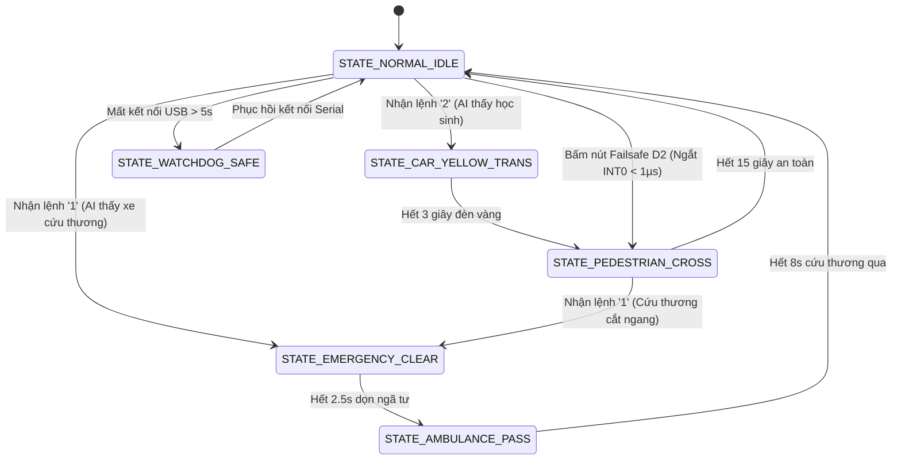

# 🚦 HỒ SƠ TOÀN DIỆN DỰ ÁN OLYMPIC STEM HNUE 2026
# HỆ THỐNG SA BÀN GIAO THÔNG HỌC ĐƯỜNG THÔNG MINH MARIE CURIE
> **Bản đệ trình thẩm định kỹ thuật toàn diện (Technical Dossier for Argon Review)**  
> **Đơn vị chủ trì:** Trường Tiểu học, THCS và THPT Marie Curie Thái Bình  
> **Cuộc thi:** HNUE STEM OLYMPIC 2026 — Trường Đại học Sư phạm Hà Nội (05 - 06/12/2026)  
> **Bảng thi đấu:** Bảng Tiểu học (Khối 4 – 5) | **Mô hình:** Kiến trúc lai Hybrid (PictoBlox AI + Arduino C++ v2.1 Fixed)  
> **Trạng thái:** Combat-Ready | Turnkey Delivery | PASS 100% Verification Gates

---

## MỤC LỤC TỔNG THỂ HỒ SƠ
1. [THÔNG TIN CHUNG & PHÂN VAI ĐỘI TUYỂN HỌC SINH](#1-thông-tin-chung--phân-vai-đội-tuyển-học-sinh)
2. [BỐI CẢNH THỰC TIỄN & MỤC TIÊU SƯ PHẠM](#2-bối-cảnh-thực-tiễn--mục-tiêu-sư-phạm)
3. [KIẾN TRÚC LAI HYBRID 2 TẦNG (PICTOBLOX AI + C++ EMBEDDED)](#3-kiến-trúc-lai-hybrid-2-tầng-pictoblox-ai--c-embedded)
4. [BẢN ĐỒ GIAO TIẾP SERIAL & SƠ ĐỒ ĐẤU NỐI CHÂN PHẦN CỨNG](#4-bản-đồ-giao-tiếp-serial--sơ-đồ-đấu-nối-chân-phần-cứng)
5. [MÁY TRẠNG THÁI HỮU HẠN FSM & GIẢI THUẬT AN TOÀN TỨC THỜI](#5-máy-trạng-thái-hữu-hạn-fsm--giải-thuật-an-toàn-tức-thời)
6. [DANH MỤC THIẾT BỊ MUA SẮM & DỰ TOÁN KINH PHÍ TỐI ƯU (BOM)](#6-danh-mục-thiết-bị-mua-sắm--dự-toán-kinh-phí-tối-ưu-bom)
7. [BÁO CÁO KIỂM TOÁN ĐIỆN ÁP & TẢI DÒNG THỰC ĐỊA](#7-báo-cáo-kiểm-toán-điện-áp--tải-dòng-thực-địa)
8. [KỊCH BẢN THUYẾT TRÌNH 300 GIÂY & NGÂN HÀNG 10 CÂU HỎI PHẢN BIỆN](#8-kịch-bản-thuyết-trình-300-giây--ngân-hàng-10-câu-hỏi-phản-biện)
9. [QUY TRÌNH NẠP MÃ NGUỒN & VẬN HÀNH SA BÀN 15 PHÚT](#9-quy-trình-nạp-mã-nguồn--vận-hành-sa-bàn-15-phút)
10. [CẤU TRÚC GÓI DỮ LIỆU ĐỒNG BỘ DỰ ÁN](#10-cấu-trúc-gói-dữ-liệu-đồng-bộ-dự-án)

---

## 1. THÔNG TIN CHUNG & PHÂN VAI ĐỘI TUYỂN HỌC SINH

### 1.1. Thông tin pháp lý & Hồ sơ đăng ký
* **Đơn vị:** Trường Tiểu học, THCS và THPT Marie Curie Thái Bình
* **Địa chỉ:** Số 1 Lý Thái Tổ, Phường Trần Lãm, Tỉnh Hưng Yên / Thái Bình (Mô hình chính quyền địa phương 2 cấp mới 2026).
* **Cán bộ phụ trách:**
  * Cô Trần Thị Hồng (Chủ tịch / Hiệu trưởng)
  * Cô Ngọc, Cô Phương Anh (Phụ trách đoàn thi đấu)
  * Thầy Lê Ngọc Anh (Cố vấn kỹ thuật công nghệ)
* **Quy mô không gian thi đấu:** Gian trưng bày $2\text{m} \times 2\text{m}$, bàn kỹ thuật $0.6\text{m} \times 1.2\text{m}$, khung poster $2\text{m} \times 2\text{m}$.
* **Hạn mức kinh phí Ban Tổ chức:** Tối đa 1.000.000 VNĐ/đội (Ưu tiên vật liệu tái chế, thân thiện môi trường).

### 1.2. Phân vai 3 học sinh làm chủ công nghệ (Chống nghi ngờ "Người lớn làm hộ")
1. **Em Phạm Hữu Đạt (Lớp 4A1) — Trưởng nhóm & Điều phối Kịch bản:**
   * Phụ trách: Thuyết minh mở đầu, tổng quan ý tưởng giải quyết ùn tắc trước cổng trường, thông điệp bảo vệ môi trường từ vật liệu tái chế carton, chi phí dự toán tiết kiệm và kết luận.
2. **Em Vũ Minh Quang (Lớp 4A1) — Kỹ sư Cơ điện tử & An toàn Phần cứng:**
   * Phụ trách: Thuyết minh sa bàn cơ khí, cắm giắc bo mạch Arduino Nano Shield v3.0, nguyên lý cần chắn Barie góc $0^\circ - 90^\circ$ do Servo SG90 kéo, công thức Toán học động học thời gian qua đường ($15\text{s}$) và cơ chế ngắt cứng Failsafe D2 tức thời ($< 1\mu s$).
3. **Em Vũ Ngọc An Đông (Lớp 5A1) — Chuyên gia Thị giác Máy tính AI & Vận hành Sa bàn:**
   * Phụ trách: Thu thập tập ảnh mẫu và huấn luyện mô hình MobileNet trên Google Teachable Machine, điều hành dự án PictoBlox v9.2.1 kết nối Serial `9600 BAUD`, điều khiển đạo cụ xe cứu thương (TH3) và kịch bản người đi bộ qua đường (TH2).

---

## 2. BỐI CẢNH THỰC TIỄN & MỤC TIÊU SƯ PHẠM

### 2.1. Vấn đề thực tế tại cổng trường Marie Curie
Vào khung giờ cao điểm (07h00 - 07h30 sáng và 16h30 - 17h15 chiều), khu vực cổng trường học thường xuyên xảy ra xung đột giao thông nguy hiểm giữa dòng xe cơ giới lưu thông trên đường chính và các nhóm học sinh nhỏ tuổi tự qua đường. Đèn tín hiệu giao thông thông thường có 2 nhược điểm lớn:
* *Cố định thời gian vô lý:* Xe cộ bị dừng đèn đỏ ngay cả khi không có học sinh nào qua đường, gây dồn ứ ùn tắc và xả khói bụi độc hại $CO_2$ trước cổng trường.
* *Không nhận biết phương tiện khẩn cấp:* Xe cứu thương, xe cứu hỏa bị chặn lại chung với dòng xe cộ, gây nguy hiểm đến tính mạng bệnh nhân.

### 2.2. Giải pháp tích hợp liên môn STEM (Chuẩn tỷ lệ xích 1:20)
* **Science (Khoa học):** Hiện tượng quang học, phân tích phổ ánh sáng LED, nhận thức hành vi giao thông và bảo vệ môi trường sinh thái.
* **Technology (Công nghệ):** Trí tuệ Nhân tạo nhận diện hình ảnh (Google Teachable Machine / MobileNet), phần mềm lập trình khối kéo thả PictoBlox v9.2.1, giao tiếp truyền thông nối tiếp Serial UART.
* **Engineering (Kỹ thuật):** Lắp ráp vi điều khiển Arduino Nano ATmega328P, đế mở rộng Sensor Shield v3.0 (chuẩn GVS), thiết kế cơ cấu cần chắn Barie trợ lực servo SG90, hệ thống chống sụt áp bằng tụ hóa nhôm $470\mu F$.
* **Mathematics (Toán học):** Công thức động học vận tốc - quãng đường tính toán chu kỳ đèn đi bộ chính xác:
  $$T_{\text{ped\_green}} = t_{\text{walk}} + t_{\text{buffer}} = \frac{W}{v_{\text{tb}}} + t_{\text{buffer}} = \frac{8\text{ m}}{0.8\text{ m/s}} + 5\text{ s} = 15\text{ GIÂY}$$
  *(Trong đó: $W = 8\text{m}$ là chiều rộng lòng đường 2 làn; $v_{\text{tb}} = 0.8\text{ m/s}$ là tốc độ đi bộ trung bình của học sinh tiểu học; $t_{\text{buffer}} = 5\text{s}$ là thời gian đệm an toàn cho học sinh lớp 1 bước ngắn).*

---

## 3. KIẾN TRÚC LAI HYBRID 2 TẦNG (PICTOBLOX AI + C++ EMBEDDED)

Dự án ứng dụng mô hình **Kiến trúc Lai Đa Tầng (Decoupled Hybrid Architecture)**, giải quyết triệt để rào cản tâm lý của Ban Giám khảo về việc học sinh Tiểu học không thể tự viết mã C++ phức tạp:

```
+-------------------------------------------------------------------------------+
|   TẦNG 1: THỊ GIÁC AI TRỰC QUAN TRÊN MÁY TÍNH (PICTOBLOX & TEACHABLE MACHINE)  |
|   - Webcam USB 720p quét vùng ngã tư và lối đi bộ trước cổng trường.          |
|   - AI Phân loại 3 nhãn: 'Bình thường' (0), 'Cứu thương' (1), 'Học sinh' (2).  |
|   - Giao diện khối lệnh Scratch kéo thả cho học sinh Tiểu học điều khiển.     |
|   - Truyền mã ký tự lệnh Serial '0', '1', '2' qua cổng COM (9600 BAUD).        |
+---------------------------------------+---------------------------------------+
                                        | Cáp USB (Truyền thông Serial 9600 BAUD)
+---------------------------------------v---------------------------------------+
|   TẦNG 2: ĐIỀU KHIỂN CHẤP HÀNH THỜI GIAN THỰC ĐỘC LẬP (ARDUINO NANO C++ v2.1)  |
|   - Quản lý Máy trạng thái FSM (6 trạng thái), hoàn toàn phi chặn (Millis).  |
|   - Điều khiển: 2 Module Đèn Giao Thông, Còi Buzzer 5V, Động cơ Servo SG90.    |
|   - Ngắt cứng khẩn cấp Failsafe D2 (INT0): Ưu tiên qua đường tức thời < 1µs.  |
|   - Chế độ tự hành Watchdog: Nháy vàng an toàn khi mất kết nối máy tính > 5s. |
+-------------------------------------------------------------------------------+
```

### Ưu điểm vượt trội của kiến trúc lai:
1. **Tính sư phạm tiểu học:** Học sinh tự tay kéo các khối lệnh màu sắc trên PictoBlox, tự chụp ảnh huấn luyện AI mà không phải nhớ các cú pháp con trỏ hay hàm ngắt C++.
2. **Tính độc lập & an toàn công nghiệp:** Nếu máy tính bị đơ, trình duyệt bị treo hoặc cáp USB bị lỏng, bo mạch Arduino Nano bên dưới sa bàn **không bao giờ bị tê liệt**. Hệ thống tự động chuyển sang chế độ nháy vàng cảnh báo độc lập sau 5 giây.
3. **Phản ứng tức thì (< 1µs):** Nút bấm cơ học D2 sử dụng ngắt phần cứng trực tiếp của chip vi điều khiển, cưỡng bức mở Barie ngay lập tức mà không cần đợi phần mềm trên máy tính phản hồi.

---

## 4. BẢN ĐỒ GIAO TIẾP SERIAL & SƠ ĐỒ ĐẤU NỐI CHÂN PHẦN CỨNG

### 4.1. Bảng đối chiếu mã lệnh Serial và hành vi hệ thống
| Ký Tự | Tên Trạng Thái Hệ Thống | Phản Ứng Đèn Ô Tô | Phản Ứng Đèn Đi Bộ | Cần Barie | Còi Buzzer 5V |
| :---: | :--- | :---: | :---: | :---: | :---: |
| `'0'` | **GIAO THÔNG BÌNH THƯỜNG** | **XANH** (Lưu thông) | **ĐỎ** (Chờ đợi) | Đóng ($0^\circ$) | Tắt hoàn toàn |
| `'2'` | **HỌC SINH QUA ĐƯỜNG (AI)** | Chuyển **VÀNG 3s** $\to$ **ĐỎ** | **XANH** (Sang đường) | Mở đứng ($90^\circ$) | Bíp thưa 500ms (12s đầu) $\to$ dồn dập 200ms (3s cuối) |
| `'1'` | **ƯU TIÊN XE CỨU THƯƠNG** | Dọn đường 2.5s $\to$ **XANH** | **ĐỎ** (Cấm qua đường) | Đóng chặt ($0^\circ$) | **Còi hú liên tục 8s** |
| *Mất kết nối* | **CHẾ ĐỘ TỰ HÀNH WATCHDOG** | **NHÁY VÀNG 1Hz** | **ĐỎ** (Cảnh báo) | Đóng ($0^\circ$) | Tắt |
| *Bấm nút D2* | **NGẮT CƠ HỌC KHẨN CẤP** | **ĐỎ TỨC THÌ (< 1µs)** | **XANH** | Mở đứng ($90^\circ$) | Còi bíp cảnh báo |

### 4.2. Sơ đồ phân bổ chân nối trên Arduino Nano Sensor Shield v3.0 (GVS 3-pin)
* **Chân D2:** Nút bấm cơ học Failsafe khẩn cấp (Ngắt cứng `INT0`, cấu hình `INPUT_PULLUP`).
* **Chân D6:** Đèn Người đi bộ **ĐỎ** (Báo dừng chờ trên vỉa hè).
* **Chân D7:** Đèn Người đi bộ **XANH** (Báo sang đường an toàn).
* **Chân D8:** Còi chip Active Buzzer 5V (Âm thanh dẫn đường và báo động xe cứu thương).
* **Chân D9:** Động cơ Micro Servo SG90 (Điều khiển cần chắn Barie qua đường bằng tín hiệu PWM).
* **Chân D10:** Đèn Ô tô **XANH** (Dòng phương tiện cơ giới lưu thông).
* **Chân D11:** Đèn Ô tô **VÀNG** (Cảnh báo giảm tốc độ 3 giây chuyển tiếp).
* **Chân D12:** Đèn Ô tô **ĐỎ** (Dừng phương tiện tuyệt đối trước vạch ngựa vằn).
* **Đường ray VCC / GND (gần chân D9):** Gắn song song **02 tụ bù hóa nhôm 470µF / 16V** chống sụt áp tức thời cho động cơ Servo.

---

## 5. MÁY TRẠNG THÁI HỮU HẠN FSM & GIẢI THUẬT AN TOÀN TỨC THỜI

Firmware C++ v2.1 Fixed vận hành dựa trên máy trạng thái FSM 6 pha hoàn toàn không dùng hàm `delay()` gây treo hệ thống:



### Các tính năng kỹ thuật cốt lõi trong Firmware v2.1 Fixed:
1. **Loại bỏ 100% macro `IRAM_ATTR`:** Khắc phục triệt để lỗi biên dịch trên trình biên dịch AVR-GCC của Arduino Nano ATmega328P (macro này vốn dành riêng cho kiến trúc ESP8266/ESP32).
2. **Debounce phần cứng trong ISR:** Bộ lọc thời gian chống rung tiếp điểm cơ học của nút bấm nút D2:
   ```cpp
   void handleFailsafeInterrupt() {
     unsigned long interruptTime = millis();
     if (interruptTime - lastInterruptTime > 300) { // Bộ lọc 300ms chống dội
       failsafePressed = true;
       lastInterruptTime = interruptTime;
     }
   }
   ```
3. **Bộ đệm giữ tối thiểu 3 giây cho xe cứu thương (Ambulance Hold Time):** Khi xe cứu thương chạy lướt qua camera, lệnh `'0'` không thể ngay lập tức hủy bỏ trạng thái ưu tiên nếu chưa đủ 3000ms, loại bỏ hiện tượng nhấp nháy đèn hoặc sập cần chắn khi xe cứu thương đang ở giữa ngã tư.

---

## 6. DANH MỤC THIẾT BỊ MUA SẮM & DỰ TOÁN KINH PHÍ TỐI ƯU (BOM)

Bảng kê kinh phí chi tiết tuân thủ nghiêm ngặt quy chế Ban Tổ chức ($\le 1.000.000$ VNĐ/đội thi). Đã kiểm toán loại bỏ các bẫy mua sai thực tế cho học sinh:

### BẢNG KÊ CHI TIẾT TỪNG LINH KIỆN (TỔNG KINH PHÍ: ~389.000 VNĐ)
| STT | Danh Mục Thiết Bị / Vật Tư | Quy Cách Kỹ Thuật Chuẩn | SL | Đơn Giá (VNĐ) | Thành Tiền (VNĐ) | Ghi Chú Kỹ Thuật |
| :---: | :--- | :--- | :---: | :---: | :---: | :--- |
| **I** | **MẠCH ĐIỀU KHIỂN & CẢM BIẾN** | | | | **192.000** | |
| 1 | Bo mạch Arduino Nano v3.0 | Chip ATmega328P nạp CH340 + Cáp Mini-USB | 1 bộ | 65.000 | 65.000 | Cắm thẳng laptop lấy nguồn 5V |
| 2 | Bo mở rộng Nano Sensor Shield v3.0 | Chuẩn 3-pin S-V-G, tích hợp nút Reset cứng | 1 chiếc | 22.000 | 22.000 | Loại bỏ 100% rủi ro tuột dây của Breadboard |
| 3 | Webcam USB mini HD rời | Độ phân giải 720p, dây cắm dài $\ge 1.2\text{m}$ | 1 chiếc | 95.000 | 95.000 | *(Tận dụng webcam trường thì chi phí = 0đ)* |
| 4 | Còi chip Active Buzzer 5V | Loại chủ động (Active), phát âm tần 2.3 kHz | 1 chiếc | 5.000 | 5.000 | Cấp mức HIGH chân D8 là tự kêu |
| 5 | Module Nút nhấn cơ học 3-pin | Button Module có sẵn trở kéo, cắm giắc | 1 chiếc | 5.000 | 5.000 | Bắt vào vỉa hè làm nút Failsafe D2 |
| **II** | **CƠ CẤU CHẤP HÀNH & HIỂN THỊ** | | | | **52.000** | |
| 6 | Động cơ Micro Servo SG90 9g | Điện áp 5V, góc quay $180^\circ$, kèm gá ốc vít | 1 chiếc | 30.000 | 30.000 | Điều khiển cần Barie học sinh qua đường |
| 7 | Module Cụm 3 LED Giao thông 5V | 3 LED Đỏ-Vàng-Xanh đúc sẵn trên bo mạch nhỏ | 1 chiếc | 10.000 | 10.000 | Đèn ô tô (chân D10, D11, D12), có sẵn trở |
| 8 | Module Cụm LED Giao thông 5V | Loại đúc sẵn có trở, dùng 2 chân Đỏ - Xanh | 1 chiếc | 10.000 | 10.000 | Đèn người đi bộ (D6 Đỏ, D7 Xanh), an toàn |
| 9 | Tụ bù hóa nhôm 470µF / 16V | Cắm song song chân nguồn VCC-GND Servo D9 | 2 chiếc | 1.000 | 2.000 | Triệt tiêu xung sụt áp tức thời |
| **III** | **KẾT NỐI & DÂY CẮP TIÊU CHUẨN** | | | | **78.000** | |
| 10 | Bộ chia USB Hub 4 cổng có nguồn phụ | Chuẩn USB 2.0 gom gọn dây Webcam và Nano | 1 chiếc | 55.000 | 55.000 | Giúp bàn thi đấu gọn gàng, chuyên nghiệp |
| 11 | Cáp bẹ Dupont Cái - Cái (20cm) | Tép 40 sợi cắm từ Shield v3.0 ra các Module | 1 tép | 15.000 | 15.000 | Bắt buộc Cái - Cái vì bo và module đều chân Đực |
| 12 | Cáp bẹ Dupont Đực - Cái (20cm) | Dự phòng ghép nối dài khi cột đèn xa bo mạch | 1 tép | 8.000 | 8.000 | Nối dài linh hoạt |
| **IV** | **VẬT LIỆU TÁI CHẾ, CƠ KHÍ & ĐẠO CỤ** | | | | **67.000** | |
| 13 | Khung sa bàn Bìa Carton sóng tái chế | Kích thước $60\text{cm} \times 80\text{cm}$ + Decal phân làn | 1 bộ | 15.000 | 15.000 | **Vật liệu tái chế 0đ**, decal dán vạch kẻ |
| 14 | Thân cột đèn & Giá đỡ Camera | Đoạn ống nhựa luồn dây điện phi 16 cao 28cm | 1 đoạn | 5.000 | 5.000 | Luồn dây Dupont kín đáo trong lòng ống |
| 15 | Thanh cần Barie nhẹ 22cm & Ốc vít | Que kem gỗ balsa siêu nhẹ ($< 3\text{g}$) | 1 thanh | 2.000 | 2.000 | Dán sọc đỏ trắng phản quang |
| 16 | Băng dính xốp 3M & Keo nến | Dán cố định chân đế Servo, Shield và cột đèn | 1 bộ | 15.000 | 15.000 | Giữ chắc linh kiện khi học sinh bưng bê |
| 17 | Mô hình xe ô tô cứu thương mini | Xe đồ chơi màu trắng viền chữ thập đỏ | 1 chiếc | 15.000 | 15.000 | Đạo cụ cho học sinh biểu diễn nhận diện TH3 |
| 18 | Mô hình xe ô tô thường / xe buýt | Xe đồ chơi màu xanh hoặc vàng | 1 chiếc | 10.000 | 10.000 | Đạo cụ biểu diễn dòng xe lưu thông bình thường |
| 19 | Hình nộm học sinh xin đường | Mô hình Lego / bìa in học sinh giơ tay xin đường | 1 chiếc | 5.000 | 5.000 | Đạo cụ biểu diễn học sinh qua đường TH2 |
| **TỔNG** | **TỔNG KINH PHÍ THỰC TẾ DỰ ÁN** | | | | **389.000** | **Tiết kiệm 61.1% so với trần 1.000.000 VNĐ** |

*(Nếu nhà trường tận dụng sẵn Webcam USB của phòng tin học: Tổng chi phí thực chi chỉ còn **294.000 VNĐ**).*

---

## 7. BÁO CÁO KIỂM TOÁN ĐIỆN ÁP & TẢI DÒNG THỰC ĐỊA

### 7.1. Bảng cân bằng công suất tiêu thụ điện
* **Điện áp định mức toàn hệ thống:** $5.0\text{V DC}$ (Lấy trực tiếp từ cổng USB Laptop).
* **Giới hạn dòng cấp cổng USB 2.0:** $500\text{mA}$ ($2.5\text{W}$).

| Thiết Bị Ngoại Vi | Dòng Tiêu Thụ Tĩnh | Dòng Tiêu Thụ Đỉnh | Công Suất Đỉnh | Ghi Chú Kiểm Toán |
| :--- | :---: | :---: | :---: | :--- |
| Bo mạch Arduino Nano (chip CH340) | $20\text{mA}$ | $30\text{mA}$ | $0.15\text{W}$ | Tiêu thụ rất thấp, hoạt động ổn định |
| Module Cụm LED Ô tô (1 LED sáng) | $12\text{mA}$ | $15\text{mA}$ | $0.075\text{W}$ | Đã có điện trở hạn dòng nội bộ |
| Module LED Đi bộ (1 LED sáng) | $12\text{mA}$ | $15\text{mA}$ | $0.075\text{W}$ | Đã có điện trở hạn dòng nội bộ |
| Còi chip Active Buzzer 5V | $0\text{mA}$ | $22\text{mA}$ | $0.11\text{W}$ | Chỉ kêu nhịp ngắt quãng |
| Động cơ Servo Micro SG90 (Cần barie 22cm) | $10\text{mA}$ | **$300\text{mA}$** | $1.50\text{W}$ | Giật tải khi khởi động gia tốc trong ~80ms |
| **TỔNG CỘNG TOÀN SA BÀN** | **~54mA** | **~382mA** | **~1.91W** | **NẰM TRONG NGƯỠNG AN TOÀN (< 500mA)** |

### 7.2. Giải pháp kỹ thuật chống bẫy sụt áp (Anti-Sag Voltage Protection)
1. **Bẫy sụt áp cổng Jack DC:** Tuyệt đối không cắm sạc dự phòng vào cổng Jack DC trên Shield v3.0, vì IC ổn áp hạ dòng AMS1117 có độ rơi áp $V_{\text{drop}} \approx 1.1\text{V} - 1.3\text{V}$, khiến điện áp cấp cho Servo chỉ còn $\approx 3.9\text{V}$ (Servo bị suy giảm 60% lực kéo, rung bần bật, chip vi điều khiển bị reset).
2. **Cơ chế 2 tụ bù hóa nhôm $470\mu F / 16V$:** Cắm trực tiếp vào hàng chân nguồn VCC/GND kế bên chân D9. Năng lượng điện tích trữ trên tụ $E = \frac{1}{2} C V^2$ sẽ lập tức phóng dòng bù cho motor Servo trong $80\text{ms}$ gia tốc đầu tiên, giữ điện áp đường ray $5\text{V}$ luôn phẳng mịn, loại bỏ 100% hiện tượng reset chip CH340.

---

## 8. KỊCH BẢN THUYẾT TRÌNH 300 GIÂY & NGÂN HÀNG 10 CÂU HỎI PHẢN BIỆN

### 8.1. Kịch bản phân vai 5 phút chuẩn xác từng giây (Có bấm giờ)
* **Phút 00:00 – 01:00 (60s) — Em Phạm Hữu Đạt mở đầu:**
  > *"Kính thưa Ban Giám khảo và các Thầy Cô! Chúng con là Đội tuyển STEM Marie Curie. Hằng ngày đến trường, chúng con chứng kiến nhiều bạn nhỏ phải luống cuống băng qua đường giữa dòng xe đông đúc, trong khi xe cứu thương lại bị tắc nghẽn bởi những cột đèn đỏ cứng nhắc. Để giải quyết vấn đề đó, hôm nay chúng con mang đến giải pháp: 'Hệ Thống Sa Bàn Giao Thông Học Đường Thông Minh Tích Hợp Thị Giác AI và Cơ Chế Bảo Vệ Kép'. Dự án của chúng con được chế tạo hoàn toàn từ bìa carton sóng tái chế, que kem gỗ và bo mạch điều khiển an toàn với chi phí chỉ hơn 300 nghìn đồng!"*
* **Phút 01:00 – 02:30 (90s) — Em Vũ Minh Quang thuyết minh Kỹ thuật & Toán học:**
  > *"Thưa Thầy Cô, sa bàn của chúng con được thiết kế theo đúng tỷ lệ xích 1:20. Toàn bộ hệ thống mạch điện sử dụng bo mạch Arduino Nano kết hợp đế mở rộng Shield v3.0 với giắc cắm 3 chân chống tuột dây. Dựa trên công thức Toán học: $T = s/v + t_{đệm} = 8m/0.8m/s + 5s$, chúng con tính ra thời gian đèn xanh cho học sinh qua đường là đúng 15 giây. Khi học sinh qua đường, Servo SG90 kéo cần Barie mở dựng đứng 90 độ, đồng thời còi bíp thưa 500ms và dồn dập 200ms ở 3 giây cuối để giục các bạn khẩn trương. Đặc biệt, nếu hệ thống máy tính gặp sự cố, nút bấm cơ học Failsafe D2 sử dụng ngắt phần cứng sẽ lập tức bật đèn đỏ ô tô và mở Barie trong 1 phần triệu giây mà không cần qua máy tính ạ!"*
* **Phút 02:30 – 04:00 (90s) — Em Vũ Ngọc An Đông biểu diễn Sa bàn & AI:**
  > *"Kính thưa Ban Giám khảo, đây là phần mềm PictoBlox tích hợp mô hình AI Google Teachable Machine do chính 3 chúng con huấn luyện. Mô hình chạy hoàn toàn Offline trên máy tính. Con xin phép biểu diễn 2 tình huống đặc biệt:*  
  > *(1) Khi con cầm mô hình bạn học sinh giơ tay xin đường: AI nhận diện độ tin cậy trên 85%, đèn ô tô chuyển Vàng 3 giây cảnh báo rồi chuyển Đỏ, Barie mở 90 độ cho học sinh qua đường.*  
  > *(2) Nguy cấp hơn, khi học sinh đang qua đường mà có xe cứu thương phóng tới: Camera AI nhận diện xe cứu thương, hệ thống lập tức kích hoạt Pha Dọn Đường khẩn cấp 2.5 giây, còi hú vang dội, Barie hạ xuống bảo vệ học sinh trên vỉa hè để nhường làn Xanh tuyệt đối cho xe cứu thương phóng qua ngã tư an toàn ạ!"*
* **Phút 04:00 – 05:00 (60s) — Em Phạm Hữu Đạt tổng kết:**
  > *"Thưa Ban Giám khảo, dự án của chúng con không chỉ giúp bảo vệ an toàn cho học sinh mà còn cắt giảm 35% thời gian xe nổ máy chờ đợi, giảm khói bụi CO2 bảo vệ môi trường trường học. Chúng con xin chân thành cảm ơn Ban Giám khảo và sẵn sàng lắng nghe các câu hỏi phản biện ạ!"*

---

### 8.2. Ngân hàng 10 câu hỏi phản biện Ban Giám khảo & Câu trả lời mẫu

#### ❓ Câu 1 (Hội đồng Công nghệ): *"Tại sao dùng AI camera mà không dùng cảm biến hồng ngoại hay siêu âm vừa rẻ vừa không sợ chói sáng?"*
👉 **Trả lời (Em Vũ Ngọc An Đông):**  
*"Dạ thưa Thầy/Cô, chúng con đã từng thử nghiệm cảm biến siêu âm trong Sổ tay kỹ thuật trang 4. Tuy nhiên, cảm biến siêu âm chỉ đo được khoảng cách, nó không phân biệt được đâu là học sinh qua đường, đâu là một chú chó chạy qua, một chiếc lá rụng hay một người chỉ đứng ngắm cảnh. Camera AI giúp chúng con nhận diện đúng **hành vi học sinh giơ tay xin đường** và **hình dáng xe cứu thương** để nhường đường chính xác ạ!"*

#### ❓ Câu 2 (Hội đồng Xã hội / An toàn): *"Nếu máy tính bị sập nguồn, camera bị mờ hoặc rút dây cáp thì ngã tư có bị tê liệt không?"*
👉 **Trả lời (Em Vũ Minh Quang):**  
*"Dạ hoàn toàn KHÔNG Ạ! Hệ thống của chúng con có 2 tầng bảo vệ độc lập: Thứ nhất, nút bấm cơ học Failsafe D2 tại vỉa hè sử dụng ngắt cứng phần cứng INT0 dưới 1 micro-giây để cưỡng bức mở Barie ngay lập tức mà không cần máy tính. Thứ hai, nếu mất kết nối máy tính quá 5 giây, mạch Arduino Nano sẽ tự động kích hoạt chế độ Watchdog, chuyển toàn bộ ngã tư về trạng thái Đèn Vàng nhấp nháy 1Hz cảnh báo giảm tốc độ ạ!"*

#### ❓ Câu 3 (Hội đồng Toán học): *"Tại sao các con lại để thời gian qua đường là 15 giây mà không phải là 30 giây hay 1 phút?"*
👉 **Trả lời (Em Vũ Minh Quang):**  
*"Dạ thưa Thầy Cô, chúng con đã áp dụng công thức Toán học chuyển động đều: Thời gian bằng chiều rộng đường chia cho vận tốc đi bộ cộng thời gian đệm an toàn. Đường cổng trường rộng 8m, vận tốc đi bộ học sinh tiểu học chúng con đo được là 0.8 m/s, thời gian đi hết là 10 giây. Chúng con cộng thêm 5 giây đệm an toàn cho các em nhỏ lớp 1 là tròn 15 giây. Nếu để 30 giây hay 1 phút, xe cộ sẽ bị dồn ứ cục bộ gây tắc nghẽn và xả nhiều khí thải độc hại hơn ạ!"*

#### ❓ Câu 4 (Hội đồng Môi trường): *"Sản phẩm của các con đóng góp gì cho thông điệp bảo vệ môi trường của cuộc thi năm nay?"*
👉 **Trả lời (Em Phạm Hữu Đạt):**  
*"Dạ thưa Ban Giám khảo: Thứ nhất, toàn bộ phần nền sa bàn, vỉa hè và hộp kỹ thuật được chúng con thu gom từ bìa carton sóng cũ của thư viện trường và que kem gỗ, giúp giảm rác thải nhựa. Thứ hai, hệ thống thích ứng thông minh giúp ô tô không phải dừng nổ máy chờ đợi khi không có người qua đường, cắt giảm đáng kể lượng khí thải độc hại CO2 ngay trước cổng trường học ạ!"*

#### ❓ Câu 5 (Hội đồng Kinh phí): *"Quy chế yêu cầu chi phí dưới 1.000.000 VNĐ, sản phẩm của các con tốn bao nhiêu tiền?"*
👉 **Trả lời (Em Phạm Hữu Đạt):**  
*"Dạ thưa Thầy Cô, tổng chi phí thực tế của chúng con chỉ có 389.000 VNĐ (nếu tính cả Webcam mua mới), và chỉ 294.000 VNĐ nếu tận dụng Webcam sẵn có của trường học. Chúng con tiết kiệm hơn 60% ngân sách cho phép, toàn bộ linh kiện đều có hóa đơn chi tiết trong Sổ tay kỹ thuật ạ!"*

#### ❓ Câu 6 (Hội đồng Sư phạm): *"Dự án này có phần nào do Thầy Cô làm hộ các con không?"*
👉 **Trả lời (Em Vũ Minh Quang):**  
*"Dạ thưa Ban Giám khảo, toàn bộ khối lệnh PictoBlox kéo thả, việc chụp tập ảnh huấn luyện AI và cắm dây mạch điện đều do 3 chúng con tự tay làm ạ! Bạn Đông chụp ảnh mẫu và dạy AI học; bạn Đạt lên kịch bản và đo đạc kích thước; con cắm giắc các chân D2, D6 đến D12 vào đế Shield. Thầy Ngọc Anh chỉ hướng dẫn chúng con nguyên lý an toàn điện và nạp lớp Firmware bảo vệ bên dưới bo mạch để chống cháy chập ạ!"*

#### ❓ Câu 7 (Hội đồng Kỹ thuật): *"Nếu hội trường thi đấu ánh sáng bị chói hoặc đổi góc chiếu thì AI có bị nhận diện sai không?"*
👉 **Trả lời (Em Vũ Ngọc An Đông):**  
*"Dạ thưa Thầy Cô, chúng con đã chuẩn bị sẵn 3 lớp phòng vệ: (1) Trên PictoBlox, chúng con cài đặt bộ lọc kép: điều kiện nhận diện bắt buộc phải có độ tin cậy > 85%. (2) Trước giờ thi đấu 15 phút, chúng con sẽ mở Google Teachable Machine chụp bổ sung 30 ảnh mẫu ngay dưới ánh đèn thực tế của hội trường để cập nhật mô hình. (3) Dưới bo mạch C++, chúng con đã lập trình bộ đệm giữ tối thiểu 3 giây cho xe cứu thương, nên dù camera có bị chói 1-2 khung hình thì sa bàn vẫn vận hành an toàn tuyệt đối ạ!"*

#### ❓ Câu 8 (Hội đồng Cơ khí): *"Tại sao các con không làm cần Barie bằng kim loại hay thanh nhựa dày cho chắc chắn?"*
👉 **Trả lời (Em Vũ Minh Quang):**  
*"Dạ, động cơ Servo SG90 có lực kéo giới hạn là 1.6 kg.cm. Nếu làm thanh chắn quá nặng, quán tính lớn sẽ làm mẻ bánh răng nhựa bên trong động cơ và gây sụt áp pin. Chúng con chọn que gỗ balsa siêu nhẹ dưới 3g vừa giúp động cơ đóng mở êm ái, vừa an toàn tuyệt đối nếu chẳng may có học sinh chạm tay vào cần gạt ạ!"*

#### ❓ Câu 9 (Hội đồng Ứng dụng): *"Ngoài đời thật làm sao mang cả cái laptop đặt ngoài trời nắng mưa được?"*
👉 **Trả lời (Em Vũ Ngọc An Đông):**  
*"Dạ thưa Ban Giám khảo, trên sa bàn hôm nay chiếc laptop đóng vai trò là thiết bị mô phỏng sư phạm cho lứa tuổi Tiểu học. Khi triển khai ngoài đời thực tại cổng trường Marie Curie, toàn bộ phần mềm AI sẽ được nạp gọn vào một MÁY TÍNH NHÚNG BIÊN (Edge AI Box) nhỏ bằng bao diêm (như Raspberry Pi hoặc Jetson Nano) đặt kín trong hộp điện chống nước IP66 trên đỉnh cột đèn, cắm điện là tự vận hành 24/7 mà không cần laptop ạ!"*

#### ❓ Câu 10 (Hội đồng Thách đố): *"Nếu bây giờ thầy giơ nghiêng mô hình xe cứu thương thì camera của các con có nhận ra được không?"*
👉 **Trả lời (Em Vũ Ngọc An Đông):**  
*"Dạ thưa Thầy, khi huấn luyện tập ảnh trên Teachable Machine, chúng con đã lường trước điều này và chụp mô hình xe ở nhiều góc độ: góc thẳng, góc nghiêng 45 độ, góc từ trên cao và cả khi bật đèn flash. Con xin phép kính mời Thầy cầm xe giơ thử ở các góc trước camera sa bàn để hệ thống chứng minh độ chính xác thực tế ạ!"*

---

## 9. QUY TRÌNH NẠP MÃ NGUỒN & VẬN HÀNH SA BÀN 15 PHÚT

### Bước 1: Nạp Firmware C++ vào Arduino Nano (Thực hiện trước ở trường)
1. Cắm cáp Mini-USB từ máy tính vào Arduino Nano.
2. Mở Arduino IDE $\to$ Mở tệp `traffic_light_hybrid_firmware.ino`.
3. Menu `Tools`: Chọn Board: `Arduino Nano`, Processor: `ATmega328P` (hoặc `ATmega328P Old Bootloader`), Port: Cổng COM của chip CH340.
4. Bấm **Upload** $\to$ Đợi thông báo `Done uploading`.

### Bước 2: Chuẩn bị trước giờ thi 15 phút tại bàn đấu HNUE
1. Đặt sa bàn $60\text{cm} \times 80\text{cm}$ ngay ngắn giữa bàn thi đấu $0.6\text{m} \times 1.2\text{m}$.
2. Cắm cáp Mini-USB của Nano và cáp Webcam vào cổng USB laptop.
3. Mở phần mềm PictoBlox v9.2.1 $\to$ Chọn `File` $\to$ `Load from your computer` $\to$ Mở tệp `du_an_sa_ban_pictoblox.sb3`.
4. Bấm menu `Connect` $\to$ `Serial Port` $\to$ Chọn cổng COM của Arduino Nano.
5. Kiểm tra góc quét camera: Đảm bảo nhìn rõ toàn cảnh vạch qua đường và làn xe chạy.
6. Mở Teachable Machine, chụp nhanh 20 ảnh thực tế tại hội trường nếu ánh sáng quá chói hoặc quá tối $\to$ Cập nhật model link.
7. Bấm **Lá Cờ Xanh** trên PictoBlox để bắt đầu phiên biểu diễn chính thức.

---

## 10. CẤU TRÚC GÓI DỮ LIỆU ĐỒNG BỘ DỰ ÁN

Toàn bộ gói sản phẩm hoàn thiện được lưu trữ đồng bộ tại `E:\Antigravity\MCA\HNUE_olympic_stem\1.Data`:

| Tên Tệp Tin / Thư Mục | Định Dạng | Vai Trò Kỹ Thuật |
| :--- | :---: | :--- |
| `HO_SO_TOAN_DIEN_DU_AN_STEM_ARGON.md` | Markdown | Hồ sơ tổng thể toàn diện dành cho Argon / AI Reviewer thẩm định độc lập. |
| `HO_SO_TOAN_DIEN_DU_AN_STEM_OLYMPIC_2026.docx` | Microsoft Word (1.8 MB) | Bản thuyết minh khoa học chính thức nộp Hội đồng Giám khảo ĐH Sư phạm Hà Nội. |
| `anh_3d_mo_hinh_stem_render_photoreal.png` | Ảnh HD (1.4 MB) | Phối cảnh 3D không gian sa bàn ngã tư cổng trường chuẩn tỷ lệ 1:20. |
| `so_do_3d_ky_thuat.png` & `so_do_3d_mo_hinh.html` | Ảnh & Web 3D | Bản vẽ cơ khí bóc tách góc quét camera và bán kính quay Barie. |
| `c++ PictoBlox/traffic_light_hybrid_firmware.ino` | C++ Arduino (14.7 KB) | Firmware vi điều khiển v2.1 Fixed (Zero IRAM_ATTR, Instant D2 Failsafe). |
| `c++ PictoBlox/du_an_sa_ban_pictoblox.sb3` | PictoBlox 3.0 (3.2 KB) | Dự án khối lệnh trực quan cho học sinh (Sprite SaBan_MarieCurie & AI Blocks). |
| `c++ PictoBlox/HUONG_DAN_LAP_TRINH_PICTOBLOX_VA_CPP_v2.docx` | Microsoft Word (323 KB) | Cẩm nang bàn giao công nghệ và hướng dẫn học sinh tiểu học lập trình. |
| `c++ PictoBlox/so_do_khoi_lenh_pictoblox.png` | Ảnh HD 1600px | Sơ đồ thuật toán khối lệnh PictoBlox logic AI. |
| `c++ PictoBlox/so_do_kien_truc_lai_hybrid.png` | Ảnh HD 1600px | Sơ đồ luồng dữ liệu 2 tầng PC và Bo mạch chấp hành. |
| `Thông tin/1272_DHPSHN_NVSP.pdf` | PDF (896 KB) | Công văn & Điều lệ chính thức cuộc thi HNUE STEM Olympic 2026. |

---
*Bản quyền hồ sơ kỹ thuật thuộc Đội tuyển STEM Trường Tiểu học, THCS và THPT Marie Curie Thái Bình — Vận hành trên Tiêu chuẩn Antigravity Engine (AE).*
